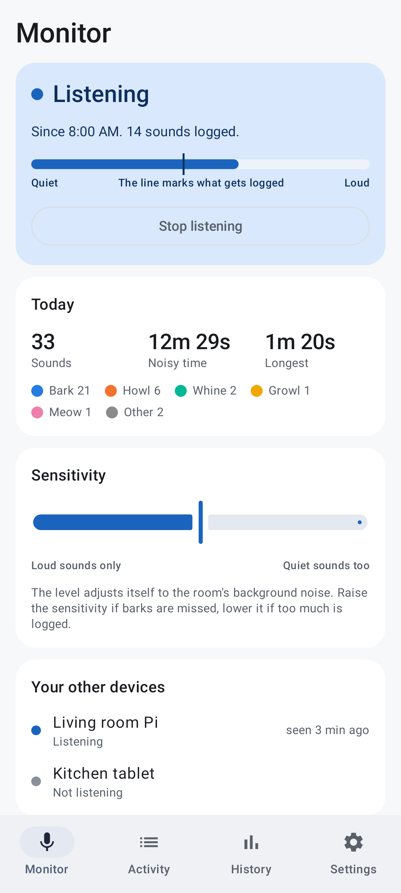
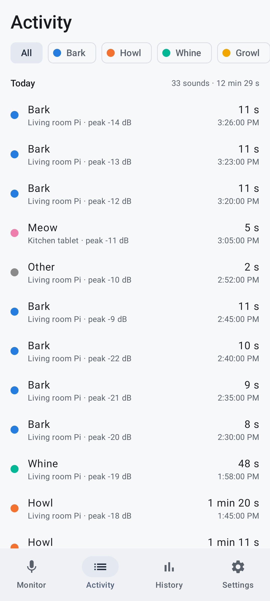
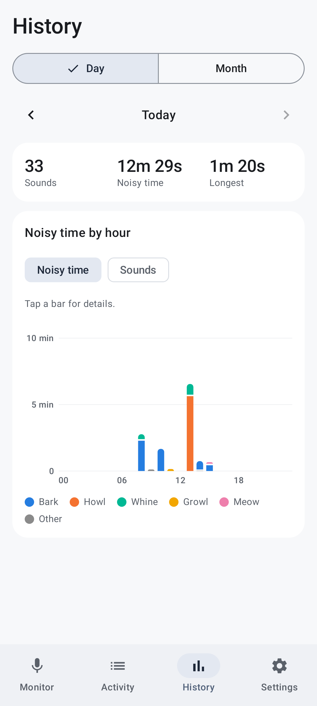

# Pet Check

Find out how much your pet barks, howls or whines while you are out.

Pet Check turns a spare Android phone, a tablet or a Raspberry Pi into a sound monitor.
It listens, recognises what kind of sound it heard, and logs **only the facts about it**:
what it was, when, how long and how loud. You can check the log from another phone.

| Monitor | Activity | History |
| --- | --- | --- |
|  |  |  |

## What it does

- **Listens in the background** with the screen off.
- **Recognises the sound**: bark, howl, whine, growl, meow, or other loud noise.
- **Keeps an activity log** and **day and month charts** of how noisy it was, and when.
- **Remote viewing**: sign in on a second device to see the log from anywhere.
- **Noise alerts**: a notification on your phone when there has been too much noise.
- **Works with no account at all**: without Firebase it is a standalone monitor.

## Privacy

Audio never leaves the monitor and is never saved. Each frame of sound is measured, kept in
memory for under a second so it can be classified, then overwritten. A logged sound is one
small record:

| Field | Example |
| --- | --- |
| type | `bark` |
| started at | 25 Nov 2026, 14:03:21 |
| duration | 4.2 s |
| peak loudness | -12 dB |
| classifier confidence | 0.82 |
| device | Living room Pi |

Remote viewing uses **your own** Firebase project, so the records sit in a database you
control. Its security rules reject any record carrying fields other than these.

## How it works

1. **Detection.** The monitor measures loudness 20 times a second and tracks the room's
   background level. A sound that stays well above that level starts an event; two seconds
   of quiet ends it. The sensitivity setting decides how far above the background a sound
   must be.
2. **Classification.** While an event lasts, the last second of audio is passed to
   [YAMNet](THIRD_PARTY_NOTICES.md), a small sound-recognition model that runs on the device.
   Its 521 labels are mapped to the six types Pet Check stores.
3. **Storage and sync.** The record is saved locally. If you are signed in it is uploaded
   to Firestore, and your other devices copy it from there.

## Get started

### Android

**Install a ready-made build.** Every CI run on GitHub produces a debug APK: open the latest
run under the repository's **Actions** tab, download the `pet-check-debug-apk` artifact and
unzip it. Copy the APK to the phone, open it, and allow your file manager or browser to
install apps when Android asks.

**Or build it yourself.** You need JDK 21 and the Android SDK (Android Studio provides both).
With the phone connected by USB and USB debugging switched on:

```bash
./gradlew installDebug
```

Then open **Pet Check**, tap **Start listening**, and allow the microphone. Android 8.0 or
newer is required.

#### Setting up a spare phone as the monitor

- Keep it plugged in. Listening for hours drains a battery.
- When the app asks to keep running in the background, tap **Allow**. Without that, Android
  may stop the monitor some time after the screen turns off.
- Some phone makers add their own battery savers on top of Android's (Xiaomi, Huawei,
  OnePlus, Samsung and others). If the monitor stops overnight, look in the phone's battery
  settings for an option to let Pet Check run unrestricted or auto-start.
- Leave it within a few metres of where your pet spends its time, with the microphone
  uncovered, and adjust **Sensitivity** on the Monitor screen until barks are logged and
  everyday background noise is not.
- If a call or another recording app takes the microphone, Pet Check shows a warning for as
  long as it cannot hear anything.

### Remote viewing (optional)

Follow [docs/firebase-setup.md](docs/firebase-setup.md) to create a free Firebase project,
then sign in with the same account on each device.

### Raspberry Pi (optional)

A Pi with a USB microphone makes a good permanent monitor. See [pi/README.md](pi/README.md).

## Project layout

| Path | What is there |
| --- | --- |
| `app/` | The Android app (Kotlin, Jetpack Compose) |
| `pi/` | The Raspberry Pi monitor (Python) |
| `firebase/` | Firestore security rules, the push-alert Cloud Function and their tests |
| `testdata/` | Detector test cases shared by the Android and Pi implementations |
| `docs/` | Setup and release guides |

## Development

```bash
# Android: unit tests, screenshot tests, a smoke test of the whole app, and lint
./gradlew testDebugUnitTest lintDebug

# Android, on a connected device or running emulator: the real sound model and microphone
./gradlew connectedDebugAndroidTest

# Raspberry Pi monitor
cd pi && python3 -m unittest discover -s tests

# Firestore rules, and the Pi monitor end to end, against the Firebase emulators
cd firebase && npm ci && npm test && npm run test:pi

# Cloud Function
cd firebase/functions && npm test
```

The screenshot tests render every screen on the JVM and write the images to
`app/build/outputs/screenshots`.

The Android and Pi monitors implement the same detector. Both are tested against
`testdata/detector_cases.txt` and both must hear the bark in `testdata/dog_bark.wav`, so a
change to one has to be made to the other.

Debug builds are signed with `debug.keystore` from the repository, so a build from any
machine installs over the previous one. See [docs/releasing.md](docs/releasing.md) for why
releases must not use that key.

## Status

This is an early version.

- Sound recognition was checked against a small set of dog, cat and household recordings.
  Barks and meows were recognised reliably. Howls, whines and growls have not been measured
  yet, and a real room is harder than a clean recording.
- Detection thresholds are first estimates. Expect to adjust the sensitivity for your room.
- Release builds are not minified yet.

Reports of what it gets right and wrong in your home are very welcome.

## Licence

[MIT](LICENSE). The bundled YAMNet model is Apache 2.0: see
[THIRD_PARTY_NOTICES.md](THIRD_PARTY_NOTICES.md).
